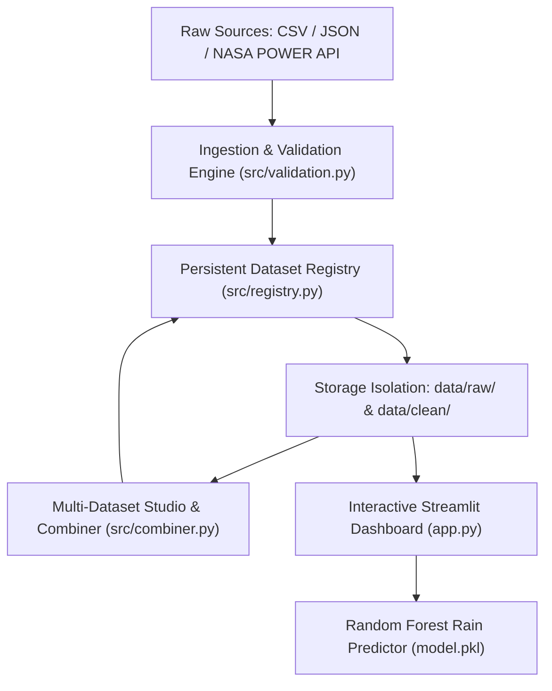

# Climate Intelligence & Multi-Dataset Studio

A full-stack climate and meteorological data intelligence platform with an enterprise-grade multi-dataset architecture, time-series combination engine, official NASA POWER API integration, and Random Forest rain forecasting.

---

## 🌟 Architecture Overview



---

## 🚀 Key Modules & Capabilities

### 1. Multi-Dataset Registry (`src/registry.py`)
- **Stable Dataset Identity:** Assigns every dataset an immutable UUID (`dataset_id`) independent of filenames.
- **Storage Isolation:** Separates raw source files (`data/raw/<dataset_id>/`) from processed artifacts (`data/clean/<dataset_id>.parquet`).
- **Atomic Catalog Persistence:** Maintains `data/registry/registry.json` using atomic replace writes with zero risk of corruption.
- **Deduplication:** Automatic SHA-256 fingerprinting prevents duplicate imports.
- **Lifecycle Management:** Full search, filtering by source/type, sorting, pagination, and safe deletion.

### 2. Validation & Ingestion Engine (`src/validation.py`)
- **Format Sniffing:** Detects CSV, TSV, JSON, JSONL, Parquet, and NASA POWER formats using structural content inspection.
- **Failure Isolation:** Batch ingestion guarantees that a single malformed file never aborts valid sibling datasets.
- **Detailed Auditing:** Generates actionable `ValidationReport` objects covering schema, missingness, and data types.
- **Safety Safeguards:** 100 MB file size limit and path traversal defenses.

### 3. Multi-Dataset Combination Studio (`src/combiner.py`)
- **Time-Series Concatenation:** Merges segmented temporal periods with automatic deduplication of overlapping dates.
- **Horizontal Feature Join:** Merges complementary parameter streams on shared date/timestamp keys with clean suffix assignment.
- **Compatibility Verification:** Rigorous checks on shared columns, data types, and key presence before any merge.
- **Provenance Preservation:** Combined datasets reference their parent dataset IDs (`parent_ids`) without mutating source records.

### 4. NASA POWER API Integration (`src/adapters/nasa_power.py`)
- **Official Client Contract:** Implements `discover`, `fetch`, `validate`, `normalize`, `metadata`, and `errors`.
- **Global Ingestion:** Query daily meteorological observations for any global latitude/longitude directly through the UI.
- **Reliability:** Built-in exponential backoff, rate limit handling (HTTP 429), and timeout management.

### 5. Interactive Streamlit Studio (`app.py`)
- **Tab 1: 📊 Dataset Dashboard:** Single-dataset deep-dive with KPIs, frequency resampling (Monthly/Weekly/Daily), Plotly charts, and tomorrow's rain probability forecast.
- **Tab 2: 🔗 Multi-Dataset Studio:** Side-by-side comparison tables, synchronized multi-station time-series graphs, and one-click validated combinations.
- **Tab 3: 🗃️ Dataset Library:** Searchable registry catalog, schema inspector, batch file uploader, and deletion guard.
- **Tab 4: 🛰️ Live NASA Ingestion:** Interactive coordinate picker with presets (Kollam, Delhi, London, NYC, Nairobi, Sydney) and parameter filters.

---

## 🛠️ Installation & Setup

1. **Clone and Navigate to Workspace:**
   ```sh
   cd C:/Users/Navan/Downloads/NASA
   ```

2. **Install Required Packages:**
   ```sh
   python -m pip install pandas plotly streamlit joblib scikit-learn requests pyarrow
   ```

3. **Launch the Application:**
   ```sh
   python -m streamlit run app.py
   ```

---

## 🧪 Automated Testing

The project includes an automated test suite across unit, integration, and UI layers:

```sh
# Run the entire test suite
python -m unittest discover tests

# Or run individual test modules:
python -m unittest tests/test_registry.py
python -m unittest tests/test_validation.py
python -m unittest tests/test_combiner.py
python -m unittest tests/test_adapters.py
python -m unittest tests/test_app_integration.py
```

---

## 🧠 Model Training

To retrain the Random Forest classifier on any dataset:

```sh
# Retrain on default baseline
python model.py

# Or retrain on any custom CSV
python model.py path/to/dataset.csv
```
